# Numaflow UI Overview

Numaflow provides a built-in user interface (UI) for monitoring and managing your data pipelines.

### Accessing the Numaflow UI

To access the Numaflow UI, use the following command to port-forward the Numaflow server:

```shell
kubectl -n numaflow-system port-forward deployment/numaflow-server 8443:8443
```

Once port-forwarding is active, open your browser and navigate to [https://localhost:8443](https://localhost:8443).

### UI Views

We have already walked through some of the views of UI to monitor pipelines in the [Quick Start](../../quick-start.md) guide.

- **Cluster View**
- **Namespace View**
- **Simple Pipeline View**
- **MonoVertex View**

### Vertex View

Vertex View provides detailed insights into each pipeline vertex. Click a vertex in a pipeline, or open a MonoVertex, to see its details. The tabs are **Pods View**, **Metrics**, **Spec**, **Processing Rates**, **K8s Events**, **Errors**, and **Buffers** (pipeline vertices only). The following features are available:

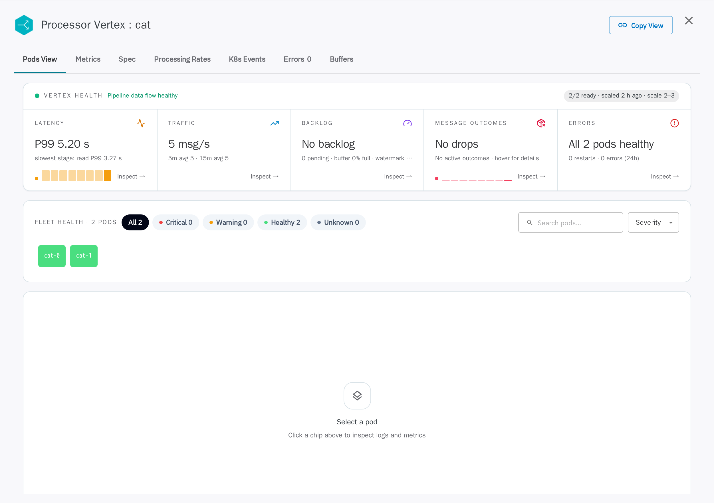

#### **[Pods View](./pods-view.md)**

Inspect the status and details of pods running in your pipelines. Check the health of the vertex and its pods at a glance.

#### **[Logs](./logs.md)**

View logs for different containers of pods to help diagnose issues. Logs open in the Pods View after you select a pod.

#### **[Metrics](./metrics-tab.md)**

Monitor pipeline metrics for performance. Shown only when the metrics proxy is configured with a Prometheus server.

#### **Spec**

View the specification of the vertex.

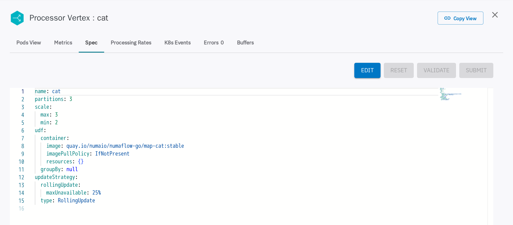

Click **Edit** to change the spec, then **Validate** and **Submit**. Click **View** to discard changes and return to read-only mode.

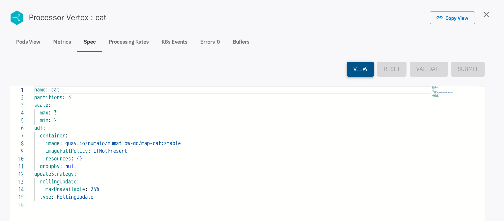

#### **Processing Rates**

See the last 1m, 5m, and 15m processing rates for each partition of the vertex.

If a Prometheus server is configured, you can click on the number to see more details in the Metrics tab.

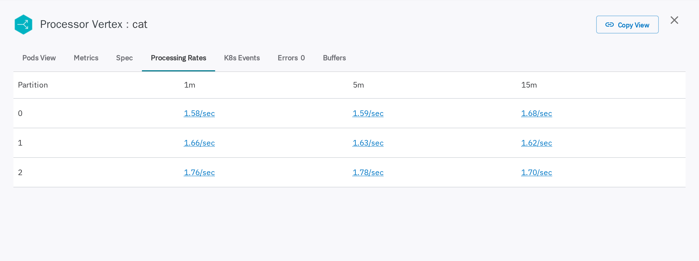

#### **Kubernetes Events**

View Kubernetes events related to the vertex.

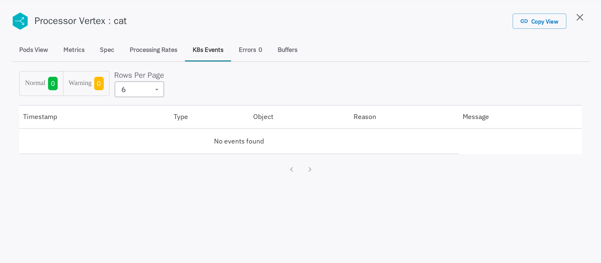

#### **[Errors](./errors.md)**

Review errors detected in your pipelines for quick debugging. The tab label shows the error count.

#### **Buffers**

See buffer details for every partition, including buffer length, usage, and number of pending messages. The table also shows whether the buffer is full and the ack pending count.
Click on the pending number to view complete pending metrics in the [Metrics tab](./metrics-tab.md).

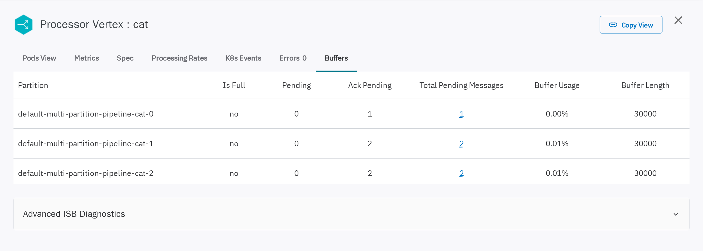

Expand **Advanced ISB Diagnostics** to see JetStream details for the vertex's buffers:

- **Consumer Information**: Redelivered messages, waiting pulls, delivered and ack floor sequences, and ack settings for each partition.
- **Stream Information**: Stored messages, bytes, first and last sequence, consumer count, replicas, and leader of each stream.
- **KV Stores**: Key-value buckets the vertex reads from or writes to, with their scope (edge, source, or sink) and number of values.
- **Monitor Errors**: Errors returned while collecting the diagnostics.

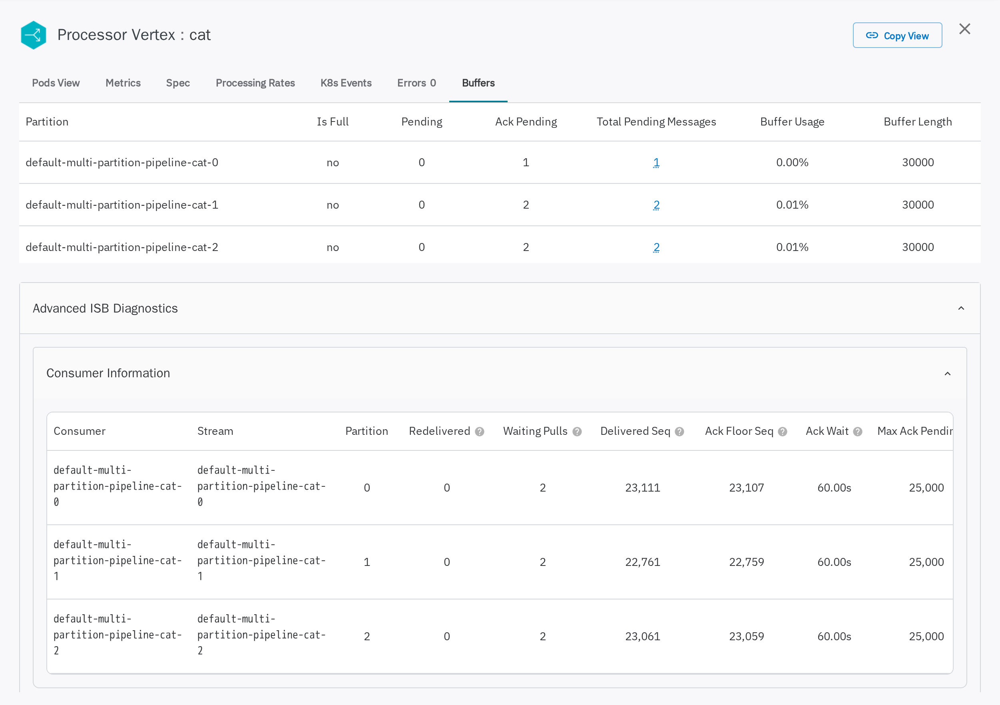

### Edge View

Click an edge in the pipeline graph to see the watermark of each partition on that edge. A value of `-1` means no watermark has been published yet.

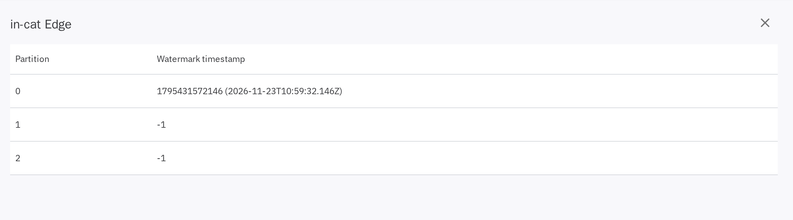

### ISB Service View

Click **View More** under **ISB Services Summary** in the pipeline view, or click **View** on an ISB service card in the namespace view.

The **JetStream** tab is shown for JetStream ISB services. It shows:

- **JetStream Summary**: Streams, consumers, messages, bytes, API requests, and API errors for each server.
- **RAFT Meta Group Information**: Leader, current, online, last active, and lag of each cluster member.
- **Monitor Errors**: Errors returned while collecting the information.

Click **Refresh** to reload the data.

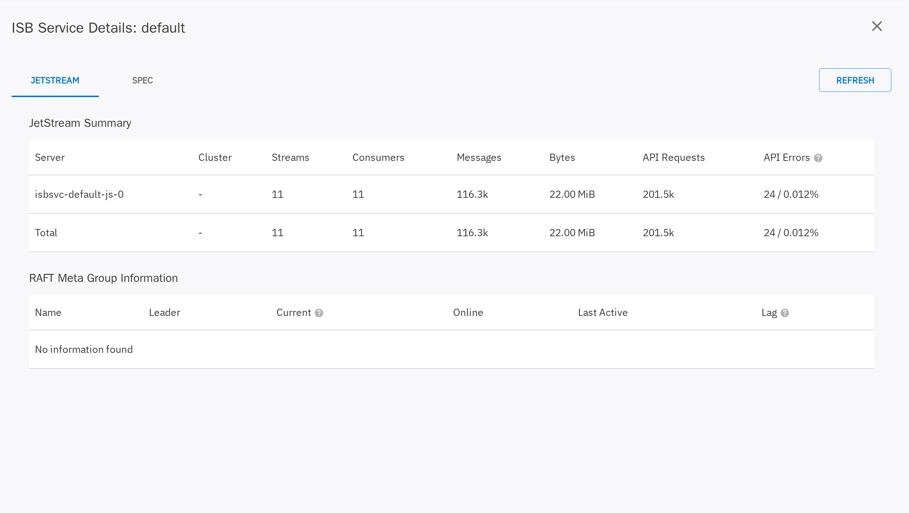

The **Spec** tab shows the ISB service specification.

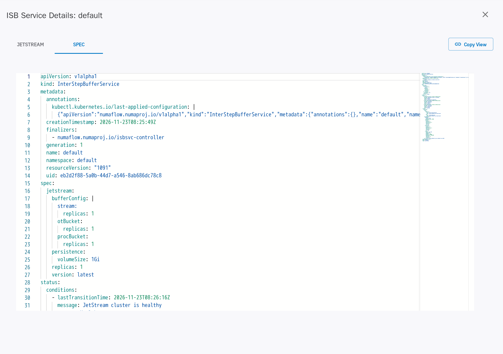

### Copy View

Every view in the vertex details panel can be shared as a link. The view state is stored in the URL, so opening the link shows the same tab, pod, log filters, spec lines, or chart.

Click **Copy View** in the panel header to copy the link for the current view. The button shows **Copied** once the link is in your clipboard.

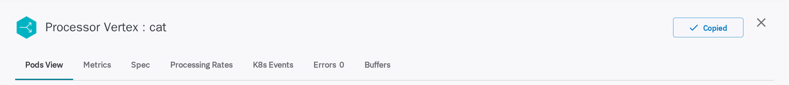

Link buttons are available in these places:

| Where | What the link opens |
|-------|---------------------|
| **Copy View** in the vertex header | The current tab with its state (pod, container, logs, spec lines). |
| **Copy View** in the [focus log view](./logs.md#2-focus-view-expanded-logs) | The expanded logs with the selected pod, container, and filters. |
| Link icon on a chart in the **Metrics** tab | That chart, with its dimension, quantile, window, and filters. |
| **Copy View** in a CPU or memory chart | That chart for the selected pod or container. |
| **Copy View** in the ISB Service **Spec** tab | The ISB service spec, with the selected lines. |

#### Share Spec Lines

On the **Spec** tab, select one or more lines in the editor, then click **Copy View**. The link highlights the same lines when opened.

```text
https://localhost:8443/?namespace=default&pipeline=multi-partition-pipeline&vertex=cat&vertexTab=spec&specLine=3-5
```

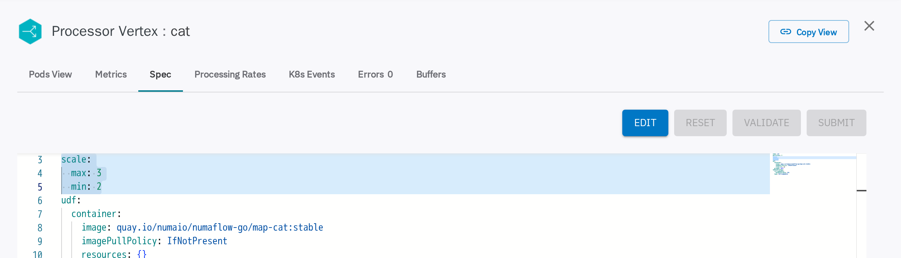

The same works for the ISB service spec:

```text
https://localhost:8443/?namespace=default&pipeline=multi-partition-pipeline&isb=default&isbTab=spec&specLine=6
```

#### Share Logs

Select a pod and container, set the log filters, then click **Copy View**. The link below opens `cat-0/numa` with the search `Watermark`, level `Info`, and the last 500 lines:

```text
https://localhost:8443/?namespace=default&pipeline=multi-partition-pipeline&vertex=cat&vertexTab=pods&pod=multi-partition-pipeline-cat-0-y5mzx&container=numa&logsSearch=Watermark&logsLevel=info&logsTail=500
```

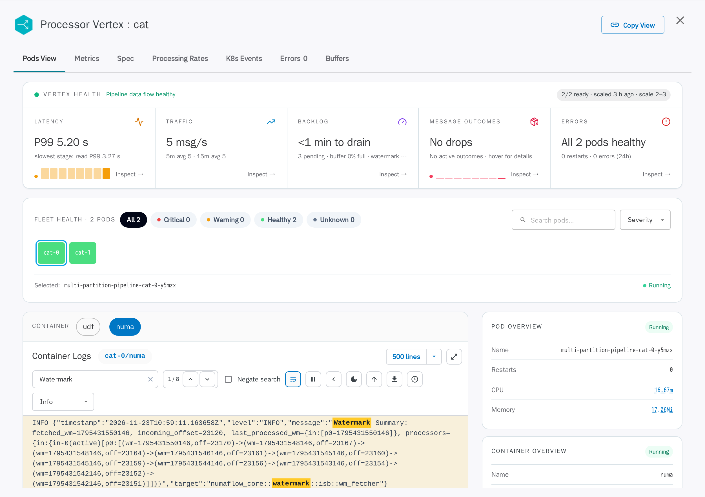

#### Share Metrics with Filters

On the **Metrics** tab, open a chart, choose the dimension, quantile, query window, and filters, then click the chart's link icon. The link below opens the MonoVertex processing time latency chart at P95 over 5 minutes, filtered to one pod:

```text
https://localhost:8443/?namespace=default&pipeline=simple-mono-vertex&type=monoVertex&vertex=simple-mono-vertex&vertexTab=metrics&metric=monovtx_processing_time_bucket&metricPanels=monovtx_processing_time_bucket-panel&metricDimension=pod&metricQuantile=0.95&metricDuration=5m&metricFilter=pod%3Asimple-mono-vertex-mv-0-gpm2e
```

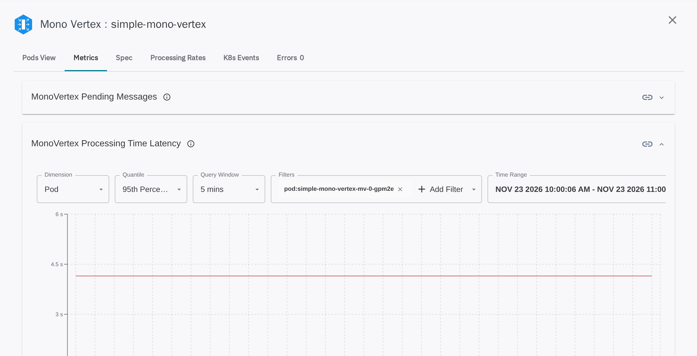

#### URL Parameters

| Parameter | Description |
|-----------|-------------|
| `vertex`, `vertexTab` | Selected vertex and tab (`pods`, `metrics`, `spec`, `processingRates`, `k8sEvents`, `errors`, `buffers`). |
| `isb`, `isbTab` | Selected ISB service and tab (`jetstream`, `spec`). |
| `specLine` | Selected spec line or range, for example `6` or `3-5`. |
| `pod`, `container` | Selected pod and container. |
| `logsSearch`, `logsNegate`, `logsLevel`, `logsTail`, `logsWrap`, `logsTimestamps`, `logsOrder`, `logsPrevious`, `logsPaused`, `logsFocus`, `logsColor` | Log toolbar settings. See [Logs](./logs.md). `logsTail` accepts `500`, `1000`, `2000`, `5000`, or `10000`. |
| `metric`, `metricPanels` | Open metric chart(s). |
| `metricDimension`, `metricQuantile`, `metricDuration`, `metricStart`, `metricEnd` | Chart settings. |
| `metricFilter` | Chart filters as `key:value` pairs separated by commas, for example `pod:simple-mono-vertex-mv-0-gpm2e`. |

> **Note**: Replace `https://localhost:8443` with the address of your Numaflow server. The person opening the link needs access to the namespace.

### Dark Mode

Click the theme icon in the top-right corner of the header to switch between **Light**, **Dark**, and **System** themes.

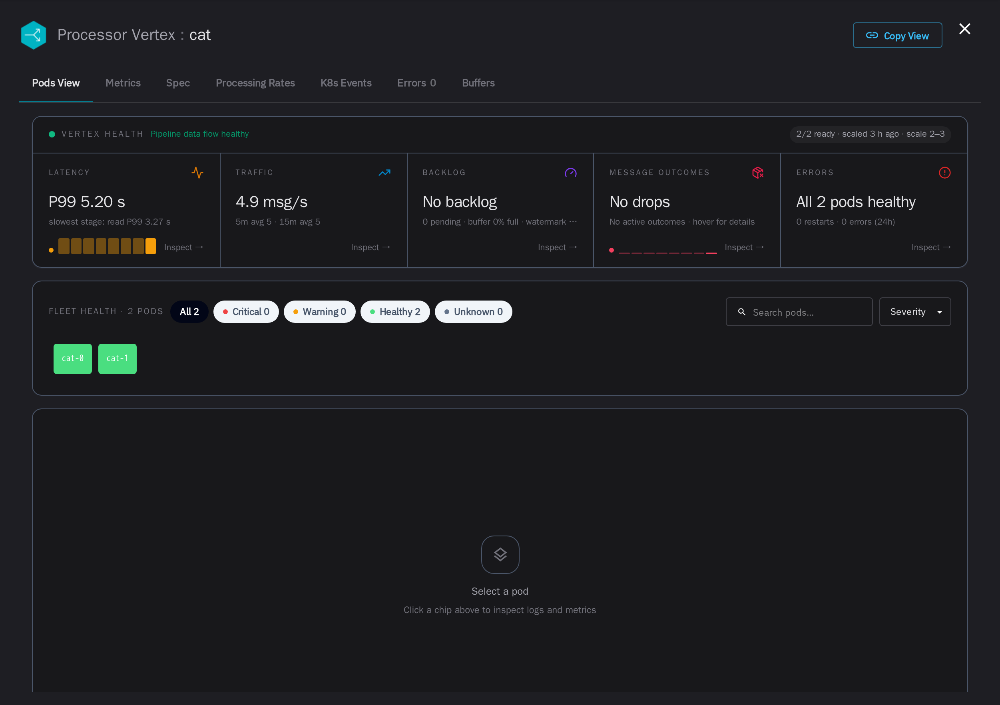

---
