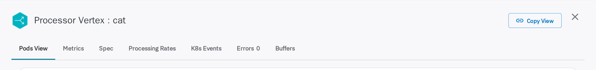
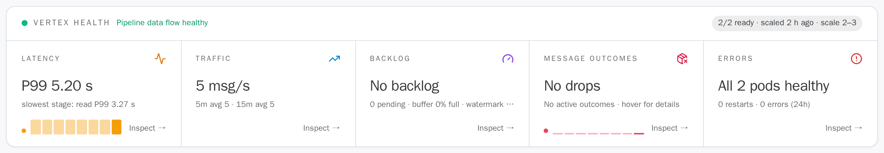
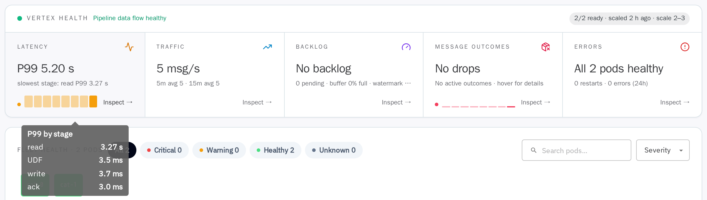
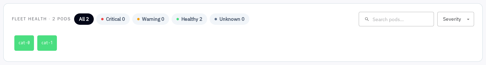
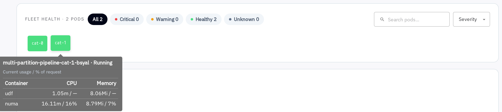
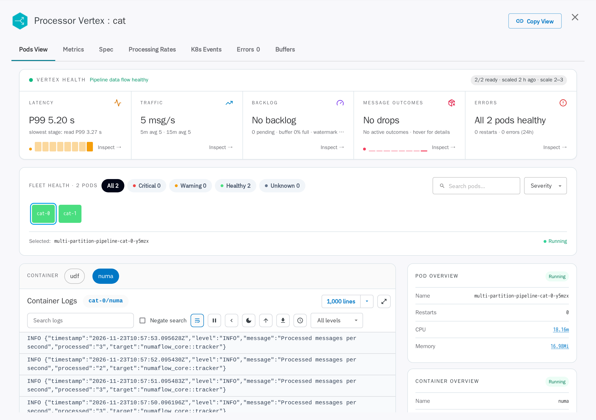
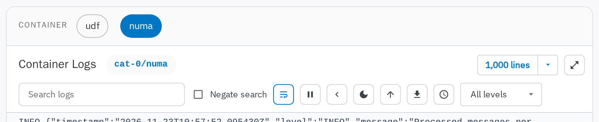
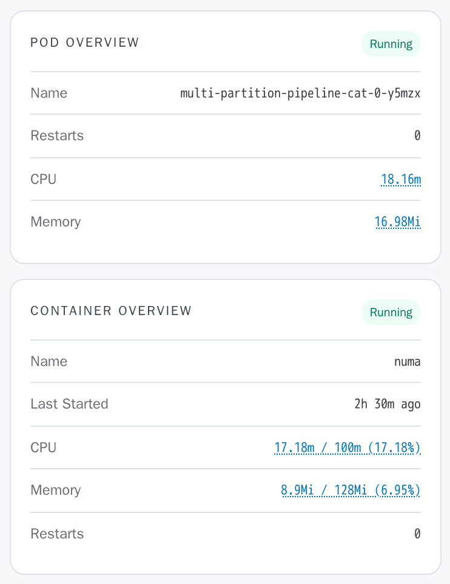

# Pods View

The **Pods View** in the Numaflow UI provides a comprehensive overview of the pods associated with a vertex. This view is designed to help users monitor the health, status, resource usage, and other key details of the pods in their application. It also allows users to perform actions such as filtering and inspecting individual pods.

Open a pipeline vertex or MonoVertex to see the vertex details panel. **Pods View** is the first tab of the vertex details panel, followed by **Metrics**, **Spec**, **Processing Rates**, **K8s Events**, **Errors**, and **Buffers** (pipeline vertices only).

The view has three parts, from top to bottom:

1. [Vertex health](#vertex-health) - golden signals for the whole vertex.
2. [Fleet health](#fleet-health) - one chip per pod.
3. [Pod and container details](#pod-and-container-details) - logs and runtime info of the selected pod.

---

## Vertex Health

The header shows an overall verdict (for example, `Pipeline data flow healthy`) and the replica status: ready replicas, time since the last scale, and the `min–max` scale range.

Each card shows a value, a short detail line, and a sparkline. Click a card (**Inspect →**) to open the related view.

| Card | Shows | Inspect opens |
|------|-------|---------------|
| **Latency** | P99 processing time over 5m and the slowest stage. | Metrics tab |
| **Traffic** | Current msg/s with 5m and 15m averages. Shows `Stalled` or `Idle` when there is no traffic. | Processing Rates tab |
| **Backlog** | Pending messages, buffer usage, watermark lag, and estimated time to drain. Shows `Pending not reported` when the source does not report pending messages. | Buffers tab (pipeline vertices only) |
| **Message Outcomes** | Drops, nacks, and fallback sink writes (MonoVertex) over the last 10m. Duplicate drops are counted separately, as they are not message loss. | Metrics tab |
| **Errors** | Unhealthy pods, restarts, errors (24h), and critical errors (10m). | The first unhealthy pod; otherwise the critical errors chart, or the Errors tab |

Hover over a card to see the breakdown. For example, **Latency** shows the P99 of each stage (read, UDF, write, ack).

> **Note**: The Latency, Message Outcomes, and critical error values come from Prometheus. If Prometheus is not configured, these cards show `Metrics unavailable`. If no metric has the required `signal` in the metrics proxy config, the card shows `Not configured`. See [Signal tags](./metrics-tab.md#signal-tags).

---

## Fleet Health

Every pod of the vertex is shown as a chip, colored by severity:

- **Critical**: The pod is not running or a container is unhealthy (for example, `CrashLoopBackOff`).
- **Warning**: A container uses more than 80% of its CPU or memory request.
- **Healthy**: The pod is running within its requests.
- **Unknown**: No status is reported for the pod.

Use the filters to show pods of one severity, the search box to find pods by name, and the sort menu to order them by **Severity**, **CPU**, **Memory**, **Restarts**, or **Name**. A dot on a chip marks a pod that has restarted.

Hover over a chip to see the current CPU and memory usage of each container, compared to its request.

Click a chip to select the pod.

---

## Pod and Container Details

Selecting a pod opens its container logs and the pod inspector.

### Select a Container

Allows users to select a container within a pod to view its [overview](#container-overview) and [logs](#container-logs). The `numa` container is selected by default.

### Container Logs

- Quickly access the logs of a specific container within a pod by selecting it.
- Refer to the [Logs View](./logs.md) section for a detailed explanation of log features.

### Pod Overview

Provides detailed information about the selected pod, including:

- **Status**: The current phase of the pod, shown as a badge. Possible values include:
    - `Pending`
    - `Running`
    - `Succeeded`
    - `Failed`
    - `Unknown`

    > **Note**: Learn more about pod phases [here](https://kubernetes.io/docs/concepts/workloads/pods/pod-lifecycle/#pod-phase).

- **Name**: The name of the pod.
- **Restarts**: The total number of restarts for all containers within the pod.
> Since pods are recreated upon termination, this value is an aggregate of container restarts.
- **CPU**: The aggregated CPU usage of all containers within the pod.
- **Memory**: The aggregated memory usage of all containers within the pod.
- **Reason**: A brief, CamelCase message indicating why the pod is in its current state (if applicable).
    - This field is populated in cases such as pod scheduling issues, eviction, termination, or node-related problems.
- **Message**: A human-readable message providing additional details about the pod's condition (if applicable).
    - This field is populated in scenarios like pod scheduling issues, eviction, termination, or node-related problems.

### Container Overview

Provides detailed information about the selected container, including:

- **Status**: The current state of the container (e.g., `Waiting`, `Running`, or `Terminated`), shown as a badge.
- **Name**: The name of the container.
- **Last Started**: The relative age of the container since it was last (re-)started.
- **CPU**: The CPU usage compared to the requested amount.
- **Memory**: The memory usage compared to the requested amount.
- **Restarts**: The number of times the container has been restarted.
- **Waiting Reason**: The reason why the container is in a waiting state (if applicable).
- **Waiting Message**: A message providing details about why the container is in a waiting state (if applicable).
- **Last Termination**: The reason for the container's last termination (if applicable). This helps debug container crashes and restarts.
- **Termination Message**: A message providing details about the last termination of the container (if applicable).
- **Exit Code**: The exit code of the last terminated container (if applicable).

If Prometheus is configured, click a CPU or memory value to open its usage chart.

> **Note**: CPU and memory values require the Kubernetes [metrics-server](https://github.com/kubernetes-sigs/metrics-server).

---

## Metrics Tab

- The **[Metrics](./metrics-tab.md)** tab sits next to **Pods View** in the vertex details panel.
- Switch to **Metrics** to view Prometheus charts for the selected vertex or MonoVertex.
- For details, refer to the [Metrics Tab](./metrics-tab.md) guide.
