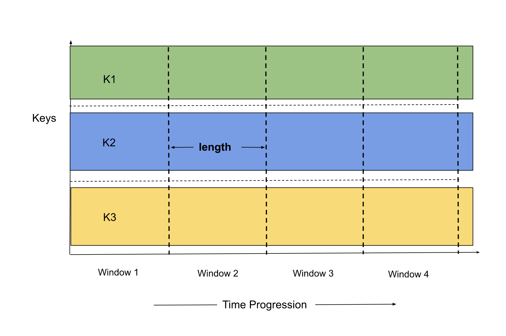

# Fixed

Fixed windows (sometimes called tumbling windows) are defined by a static window size, e.g. 30 second
windows, one minute windows, etc. They are generally aligned, i.e. every window applies across all
the data for the corresponding period of time. It has a fixed size measured in time and does not
overlap. The element which belongs to one window will not belong to any other tumbling window.
For example, a window size of 20 seconds will include all entities of the stream which came in a
certain 20-second interval.



## Configuration

To enable Fixed window, we use `fixed` under `window` section.

```yaml
vertices:
  - name: my-udf
    udf:
      groupBy:
        window:
          fixed:
            length: duration
```

NOTE: A duration string is a possibly signed sequence of decimal numbers, each with optional fraction
and a unit suffix, such as "300ms", "1.5h" or "2h45m". Valid time units are "ns", "us" (or "µs"), "ms", "s", "m", "h".

### Length

The `length` is the window size of the fixed window.

## Example

A 60-second window size can be defined as following.

```yaml
vertices:
  - name: my-udf
    udf:
      groupBy:
        window:
          fixed:
            length: 60s
```

The yaml snippet above contains an example spec of a _reduce_ vertex that uses fixed window 
aggregation. As we can see, the length of the window is 60s. This means only one window will be 
active at any point in time. It is also possible to have multiple inactive and non-empty windows
(based on out-of-order arrival of elements).

The window boundaries for the first window (post bootstrap) are determined by rounding down from
`time.now()` to the nearest multiple of `length` of the window. So considering the above example,
if the `time.now()` corresponds to `2031-09-29T18:46:30Z`, then the start-time of the window will
be adjusted to `2031-09-29T18:46:00Z` and the end-time is set accordingly to `2031-09-29T18:47:00Z`.
Windows are left inclusive and right exclusive which means an element with event time (considering
event time characteristic) of `2031-09-29T18:47:00Z` will belong to the window with boundaries
`[2031-09-29T18:47:00Z, 2031-09-29T18:48:00Z)`

It is important to note that because of this property, for a constant throughput, the first window 
may contain fewer elements than other windows.

Check the snippets below to see the UDF examples for different languages.

=== "Go"

    ```go
    func reduceCounter(_ context.Context, keys []string, inputCh <-chan reducer.Datum, md reducer.Metadata) reducer.Messages {
        // count the incoming events
        var resultKeys = keys
        var resultVal []byte
        var counter = 0
        for range inputCh {
            counter++
        }
        resultVal = []byte(strconv.Itoa(counter))
        return reducer.MessagesBuilder().Append(reducer.NewMessage(resultVal).WithKeys(resultKeys))
    }
    ```
    [View the full example on numaflow-go GitHub](https://github.com/numaproj/numaflow-go/tree/main/examples/reducer/counter)

=== "Python"

    ```python
    async def reduce_handler(keys: list[str], datums: AsyncIterable[Datum], md: Metadata) -> Messages:
        interval_window = md.interval_window
        counter = 0
        async for _ in datums:
            counter += 1
        msg = (
            f"counter:{counter} interval_window_start:{interval_window.start} "
            f"interval_window_end:{interval_window.end}"
        )
        return Messages(Message(str.encode(msg), keys=keys))
    ```
    [View the full example on numaflow-python GitHub](https://github.com/numaproj/numaflow-python/tree/main/packages/pynumaflow/examples/reduce/counter)

=== "Java"

    ```java
    public class SumFunction extends Reducer {
        private int sum = 0;

        @Override
        public void addMessage(String[] keys, Datum datum, Metadata md) {
            try {
                sum += Integer.parseInt(new String(datum.getValue()));
            } catch (NumberFormatException e) {
                log.info("error while parsing integer - {}", e.getMessage());
            }
        }

        @Override
        public MessageList getOutput(String[] keys, Metadata md) {
            return MessageList
                    .newBuilder()
                    .addMessage(new Message(String.valueOf(sum).getBytes()))
                    .build();
        }
    }
    ```
    [View the full example on numaflow-java GitHub](https://github.com/numaproj/numaflow-java/tree/main/examples/src/main/java/io/numaproj/numaflow/examples/reduce/sum)

=== "Rust"

    ```rust
    #[async_trait]
    impl Reducer for Counter {
        async fn reduce(
            &self,
            keys: Vec<String>,
            mut input: Receiver<ReduceRequest>,
            _md: &Metadata,
        ) -> Vec<Message> {
            let mut counter = 0;
            while input.recv().await.is_some() {
                counter += 1;
            }
            vec![Message::new(counter.to_string().into_bytes()).with_keys(keys.clone())]
        }
    }
    ```
    [View the full example on numaflow-rs GitHub](https://github.com/numaproj/numaflow-rs/tree/main/examples/reduce-counter)


## Streaming Mode

Reduce can be enabled on streaming mode to stream messages or forward partial responses to the next vertex.
This is useful for custom triggering, where we want to forward responses to the next vertex quickly,
even before the fixed window closes. The close-of-book and a final triggering will still happen even if
partial results have been emitted.


To enable reduce streaming, set the `streaming` flag to `true` in the fixed window configuration.

```yaml
vertices:
  - name: my-udf
    udf:
      groupBy:
        window:
          fixed:
            length: duration
            streaming: true # set streaming to true to enable reduce streamer
```

Note: UDFs should use the ReduceStreamer functionality in the SDKs to use this feature.

Check the snippets below to see the UDF examples in streaming mode for different languages.

=== "Go"

    ```go
    // reduceCounter is a ReduceStreamer that counts the incoming events and outputs the count every 10 events.
    func reduceCounter(_ context.Context, keys []string, inputCh <-chan reducestreamer.Datum, outputCh chan<- reducestreamer.Message, md reducestreamer.Metadata) {
        var resultKeys = keys
        var resultVal []byte
        var counter = 0
        for range inputCh {
            counter++
            if counter >= 10 {
                resultVal = []byte(strconv.Itoa(counter))
                outputCh <- reducestreamer.NewMessage(resultVal).WithKeys(resultKeys)
                counter = 0
            }
        }
        resultVal = []byte(strconv.Itoa(counter))
        outputCh <- reducestreamer.NewMessage(resultVal).WithKeys(resultKeys)
    }
    ```
    [View the full example on numaflow-go GitHub](https://github.com/numaproj/numaflow-go/tree/main/examples/reducestreamer/counter)

=== "Python"

    ```python
    class ReduceCounter(ReduceStreamer):
        def __init__(self, counter):
            self.counter = counter

        async def handler(
            self,
            keys: list[str],
            datums: AsyncIterable[Datum],
            output: NonBlockingIterator,
            md: Metadata,
        ):
            async for _ in datums:
                self.counter += 1
                if self.counter > 10:
                    msg = f"counter:{self.counter}"
                    await output.put(Message(str.encode(msg), keys=keys))
                    self.counter = 0
            msg = f"counter:{self.counter}"
            await output.put(Message(str.encode(msg), keys=keys))
    ```
    [View the full example on numaflow-python GitHub](https://github.com/numaproj/numaflow-python/tree/main/packages/pynumaflow/examples/reducestream/counter)

=== "Java"

    ```java
    public class SumFunction extends ReduceStreamer {
        private int sum = 0;

        @Override
        public void processMessage(
                String[] keys,
                Datum datum,
                OutputStreamObserver outputStreamObserver,
                Metadata md) {
            try {
                sum += Integer.parseInt(new String(datum.getValue()));
            } catch (NumberFormatException e) {
                log.info("error while parsing integer - {}", e.getMessage());
            }
            if (sum >= 100) {
                outputStreamObserver.send(new Message(String.valueOf(sum).getBytes(), keys));
                sum = 0;
            }
        }

        @Override
        public void handleEndOfStream(
                String[] keys,
                OutputStreamObserver outputStreamObserver,
                Metadata md) {
            outputStreamObserver.send(new Message(String.valueOf(sum).getBytes()));
        }
    }
    ```
    [View the full example on numaflow-java GitHub](https://github.com/numaproj/numaflow-java/tree/main/examples/src/main/java/io/numaproj/numaflow/examples/reducestreamer/sum)

=== "Rust"

    ```rust
    #[async_trait]
    impl ReduceStreamer for StreamingCounter {
        async fn reducestream(
            &self,
            keys: Vec<String>,
            mut input: Receiver<ReduceStreamRequest>,
            output: Sender<Message>,
            _md: &Metadata,
        ) {
            let mut counter = 0;
            // Stream intermediate results every 10 messages
            while input.recv().await.is_some() {
                counter += 1;
                if counter % 10 == 0 {
                    let message = Message::new(format!("intermediate: {}", counter).into_bytes())
                        .with_keys(keys.clone());
                    if output.send(message).await.is_err() {
                        return;
                    }
                }
            }
            // Send final count when the window closes
            let final_message =
                Message::new(format!("final: {}", counter).into_bytes()).with_keys(keys.clone());
            let _ = output.send(final_message).await;
        }
    }
    ```
    [View the full example on numaflow-rs GitHub](https://github.com/numaproj/numaflow-rs/tree/main/examples/reduce-stream-counter)


